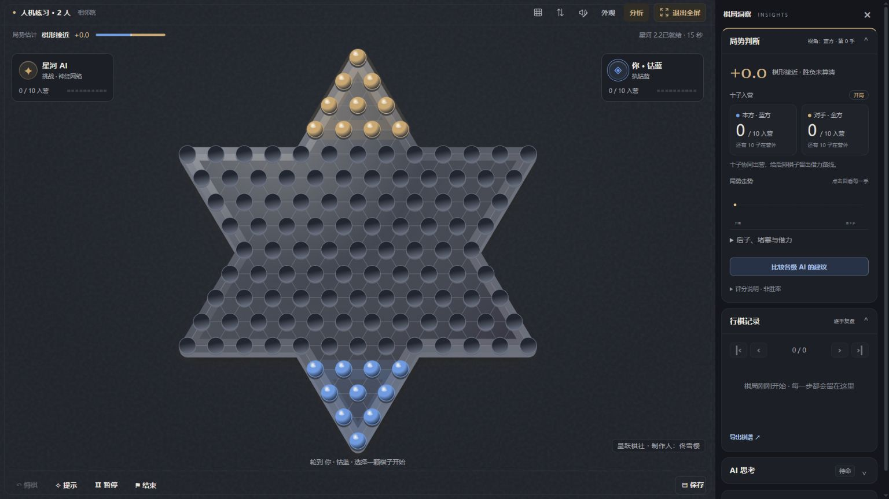

# 星跃棋社 · Starhop Club 2.2

**制作人：佟雪樱** · 源码公开 · 非商业使用 · 必须注明使用范围

中国跳棋对弈与复盘软件。121 孔星形棋盘，十子入营；支持人机、同屏多人、AI 自战与本地存档。

[下载完整版本](https://github.com/Icarus0802/starhop-club/releases/tag/v2.2.0) · [在线试玩](https://icarus0802.github.io/starhop-club/) · [授权条款](LICENSE) · [署名示例](ATTRIBUTION.md)



## 下载即玩

- **Windows 完整版**：下载 `Starhop-Club-2.2.0-Windows-x64.zip`，全部解压到可写目录，双击 `启动跳棋.cmd`。自带 Node、本机神经网络和权重，无需安装 npm。关闭网页后双击 `退出跳棋.cmd` 停止后台服务。
- **浏览器轻量版**：下载 `Starhop-Club-2.2.0-Browser.zip`，解压打开 `index.html`，或在线试玩。使用浏览器 AI，棋力与 Windows 本机神经网络版不同。
- **开发源码**：下载 `source.zip` 或克隆仓库，Node.js 18+，执行 `npm start`。源码不带大型原生运行文件；缺少模型时自动使用浏览器 AI。

Windows 完整版适用 Windows 10/11 x64；原生模型需要可用的 OpenCL 显卡驱动。第一次启动可能需要数分钟进行设备调优。棋室显示“星河 2.2 已就绪”才表示模型成功加载；失败时仍能使用浏览器 AI。详见 [第三方组件](THIRD_PARTY.md)。

默认本地地址 `http://127.0.0.1:5173/`，端口占用时自动寻找空闲端口。存档与上传背景按浏览器和地址保存在本机，更换地址前请导出棋谱。

## 本版功能

- 星河 2.2 本机挑战档：默认每步最多 15 秒，保留神经网络搜索树，增加深度收官规划和路线复核。支持双人对角、相邻跳、不锁营；其他局面自动使用浏览器搜索。
- 双人默认启用自身阵形第三次重复判负，第二次重复提示；AI 搜索与最终落子均检查重复。旧棋谱按记录的规则复盘。
- 实时局势、入营进度、整盘走势、收官估计、逐手复盘与 JSON 导入导出。评分不是胜率，手动结束不再误标和棋。
- 暖白棋室、深色棋室、星梦庭院等可切换主题；背景、棋盘材质、棋子配色、走子特效独立设置。支持樱花粉棋子、樱粉玉棋盘与自定义背景。
- 棋盘光影、连跳路径、木音/琉璃音效、音量控制、网页全屏和窄屏布局。
- 棋盘可见制作人水印、关于页署名与棋谱导出工具来源。

当前 2.2 是用户实战体验后批准发布的版本。尚未完成两轮十局全胜验收，不宣称冠军评级或稳定胜过某一真人；旧版测试数字不作为本版成绩。验证范围见 [发布验证](docs/VALIDATION.md)。

## 使用许可

本版新增原创部分允许非商业使用、学习、修改和无偿分享。**必须注明“制作人：佟雪樱”、来源、版本、具体使用文件/模块及使用位置，并说明修改；不得冒充原创，不得商业盈利使用。** 具体范围见 [LICENSE](LICENSE)、[范围清单](docs/LICENSING_SCOPE.json) 和 [ATTRIBUTION.md](ATTRIBUTION.md)。

该非商业限制不符合 [OSI 的开源定义](https://opensource.org/osd)，因此本项目准确表述为“源码公开、非商业授权”。历史已按 MIT 分发的代码继续保留原权利；第三方引擎、权重和上游组件仍按各自许可，不属于本项目独占原创。用户棋谱和上传图片不因使用本软件而归制作人所有。

## 开发

```sh
npm test
npm run build
npm start
python scripts/package.py
```

修改搜索模块后重新生成 `js/worker-bundle.js`。本机引擎依赖散列保存在 `docs/release-manifest.json`；更改引擎源文件时应重新验证并更新清单，不应绕过完整性检查。源码保留当前引擎、必要的回归测试及其对照依赖；开发过程中的缓存、个人日志、旧打包副本和未使用候选不随版分发。
