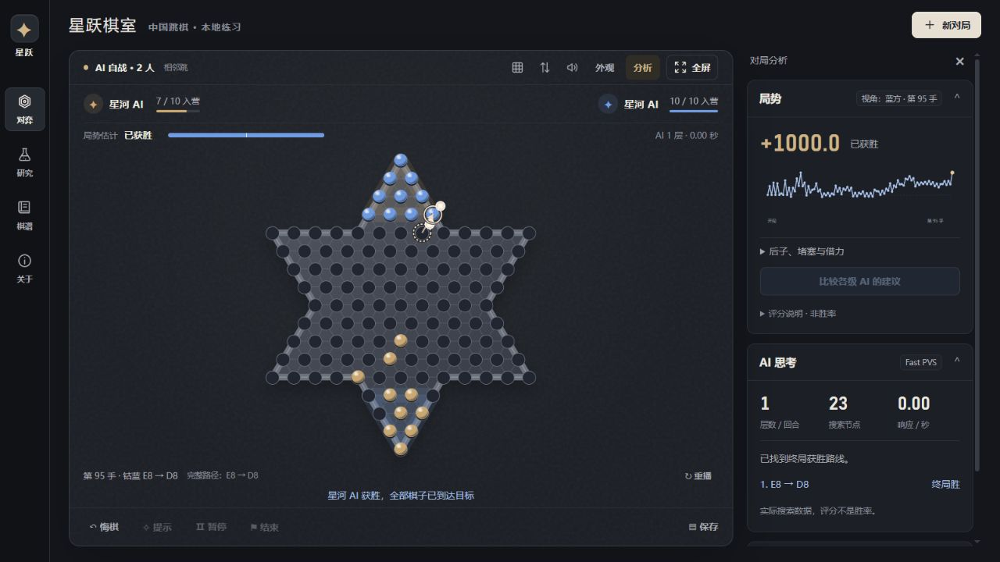

# 星跃棋社 · Starhop Club

**中国跳棋软件 · 正式版 2.0**（`2.0.0`）。121 孔六角星棋盘，十子对角竞速。MIT 开源。

**[在线试玩](https://icarus0802.github.io/starhop-club/)** · [源码](https://github.com/Icarus0802/starhop-club) · [测试记录](docs/VALIDATION.md) · [研究路线](docs/AI_RESEARCH.md)



2.0 实机界面，展示独立测试棋室的 AI 自战。右上角“全屏”可放大棋盘，“外观”可切换配色或上传本地背景。在线版使用浏览器 AI；本机神经网络请使用 Windows 完整包。

本机最高档已接入 Kata 一子跳模型：在五组新开局换先、双方每手预算均为 350ms 的十局对照中，对原最高档 **10 胜 0 负，平均收官领先 3.3 步**。这里的领先是终局后冻结胜方棋子、精确求出的败方最少收官回合数。平均实际耗时 315ms，详见[完整验收记录](docs/benchmarks/kata-acceptance-20261011/acceptance.json)及[测试说明](docs/VALIDATION.md)。

## 功能

- 默认石墨配色，另有午夜蓝、暖砂选项；取消立绘。支持本地图片背景、压暗和恢复纯色，图片保存在浏览器 IndexedDB。
- 棋盘常显局势估计和双方入营进度；桌面右侧保留走势与 AI 思考，窄屏下方保留完整分析。键盘方向键浏览棋盘，Enter / Space 选子与落子。
- 清晰的上一手起落点、箭头、编号连跳路径与动画重播；支持浏览器全屏，不支持时铺满当前网页，Esc 可退出。
- 人机练习、AI 自战、同屏多人、多人混战；2 / 3 / 4 / 6 人。
- 相邻跳、等距长跳、可选目标营地锁定；连跳路径自动枚举。
- 五档快速预算：入门 classic；基础与最高 Fast PVS；中档团队运输规划；多人 MCTS。
- 两盘华夏的汉子与浪潮九霄公开实战，178 着独立转录并逐帧、逐着验证，可导入复盘与分析。
- 十子与十个目标孔精确匹配、滞后棋子评估、置换表、历史与杀手走法排序。
- 最高档相邻跳增加后子孤立惩罚，减少队友先入营、尾子失去借力的情况；保持 350ms 默认预算。验证细节见测试记录。
- 最高档对四个无关侧营和偏离中央路线的落点计入代价，允许连跳借道。对上一版本六局同预算配对测试为 5 胜 1 负，不代表人类评级。
- **局势分析**：固定视角整盘评分走势、入营进度、目标匹配距离、后子最远距离、运输风险、借力与出口代价、双方后子与孤子定位。点击曲线逐手复盘。
- **多级 AI 对照**：同一局面分别运行基础、进阶、高手搜索，显示真实建议、完成深度与耗时。
- 悔棋、AI 提示、保存棋谱、JSON 导入导出、JSONL 训练局面导出。
- 本地浏览器自动保存；无账号、无 CDN。基础版本使用本机 Web Worker；已装载并通过验收的原生模型由本地 Node 服务调用 GPU。

## 下载即玩

到 [Releases](https://github.com/Icarus0802/starhop-club/releases) 下载：

- **Windows 完整版**：`Starhop-Club-2.0.0-Windows-x64.zip`，全部解压，双击 `启动跳棋.cmd`。内含 Node 运行时、经过散列核验的 Kata 引擎与权重，无需 npm install。结束后双击 `退出跳棋.cmd`。
- **浏览器轻量版**：`Starhop-Club-2.0.0-Browser.zip`，解压打开 `index.html`。Windows / macOS / Linux 的现代浏览器可用，运行内置浏览器 AI，不含原生神经网络。
- **开发源码**：`source.zip`。安装 Node.js 18+ 后运行 `npm start`，或直接打开 HTML 使用浏览器 AI。

Windows 完整版面向 Windows 10/11 x64。原生模型需要支持 OpenCL 的显卡驱动与 Visual C++ 2015–2022 x64 运行库。首次启动可能需要数分钟显卡调优；棋室显示“本机神经网络已就绪”才表示加载成功。模型不可用时自动回退到浏览器 AI。

默认地址 `http://127.0.0.1:5173/`；被占用时自动选择后续端口，不关闭其他程序。存档和背景按浏览器与地址保存，更换浏览器或端口前请导出 JSON。无需账号、无需云服务，关闭网页后可用退出脚本停止后台。

本机 Kata 的支持范围为双人对角、相邻跳、目标营地不锁定；不支持的规则或侧营局面使用内置搜索。引擎及权重来自[官方一子跳发布包](https://github.com/hzyhhzy/KataGomo_fork/releases/tag/20240406)，来源、许可与规则差异见 [THIRD_PARTY](THIRD_PARTY.md) 和 [研究记录](docs/AI_RESEARCH.md)。

| 等级 | 默认每步预算 | 双人默认引擎 |
| --- | ---: | --- |
| 小跳 · 入门 | 60ms | classic |
| 青竹 · 基础 | 80ms | Fast PVS |
| 飞跃 · 进阶 | 120ms | Team planner |
| 玄石 · 高手 | 220ms | Team planner |
| 星河 · 挑战 | 350ms | 本机 Kata（已安装且验收匹配）；其他环境 Fast PVS |

长跳或目标营地锁定采用 Fast PVS。实际耗时受设备和负载影响；AI 实验室支持更长手动预算。等级名称表示搜索配置，没有对应人类段位。最高 Fast 350ms 对旧最高 900ms 的四局对照为 2 胜 2 负；同预算对 Team 为 4 胜 0 负。这是小样本内部对照，不能推断冠军胜率。见[1.2 验证记录](docs/VALIDATION.md)与[大师研究](docs/MASTERS_RESEARCH.md)。

## 分析分数怎么读

正分表示所选视角相对领先，负分表示落后。多人时与当前位置最领先的对手比较。它是位置启发式评分，**不是胜率、不是等级分、不是保证剩余步数**。后子与孤子风险取决于当前可借力条件；未来搭桥和阻挡需要更深入搜索。

不同预算建议一致，可作为学习参考；意见不同说明搜索存在不确定性。判断棋力仍需交换先后手、多局实战，并使用统一规则与思考时间。

## 开发与验证

```sh
npm test
npm run build
node scripts/bench-fast.cjs
npm run arena -- --games 2 --time 200 --a 4 --b 4 --baseline legacy --max 300
```

修改 `js/engine.js`、`js/ai.js` 或 `js/worker.js` 后，请重新生成 `js/worker-bundle.js`。这个打包文件使离线 `file://` 模式也能使用工作线程。

```text
js/engine.js       共享规则与棋谱验证
js/ai.js           搜索内核
js/analysis.js     位置诊断（与搜索评估分离）
js/analysis-ui.js  趋势与不同级别建议对照
js/app.js          对弈、存档与复盘
tests/            规则、搜索、实际棋谱与工作线程测试
benchmarks/       旧版与未通过验证的实验评估器
vendor/upstream/  保留的 MIT 上游来源
```

## 正式版范围

当前提供本地练棋与分析。联网匹配、账号、排名和多人联机服务尚未实现。本机最高档可调用已验证的 Kata 预训练模型；十局对旧版的成绩不构成真人评级。浏览器版继续使用预计算几何、紧凑走法与置换表的 Fast PVS，以及真实连跳借力和多回合团队运输规划。未通过对照的实验评估保留在 benchmarks 中。

欢迎提交带完整棋谱、规则、思考预算和设备信息的实战问题。棋谱仅存在浏览器本地，软件不会自动上传。

## 许可

MIT，见 [LICENSE](LICENSE)。棋盘与连跳逻辑改编自 `jumpogpo/ai-chinese-checker`，保留 © 2022 arthur-x，具体来源见 [THIRD_PARTY.md](THIRD_PARTY.md)。研究项目仅作为资料引用，未复制无明确许可证的模型或代码。
