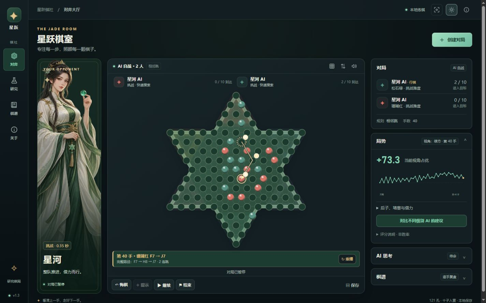

# 星跃棋社 · Starhop Club

**中国跳棋软件 · 正式版 1.3**（`1.3.0`）。121 孔六角星棋盘，十子对角竞速。MIT 开源。

**[在线试玩](https://icarus0802.github.io/starhop-club/)** · [源码](https://github.com/Icarus0802/starhop-club) · [测试记录](docs/VALIDATION.md) · [研究路线](docs/AI_RESEARCH.md)



实机界面，展示独立测试棋室的40手AI自战。手机可用顶栏专注按钮放大棋盘。

## 功能

- 东方轻幻想棋室与原创透明立绘；深色、浅色主题，专注棋盘模式。配色偏好与棋谱独立保存。
- 分层收起搜索、棋谱和后子细节，手机底部导航；键盘方向键浏览棋盘，Enter / Space 选子与落子。
- 清晰的上一手起落点、箭头、编号连跳路径与动画重播；窄屏底部导航与大棋盘。
- 人机练习、AI 自战、同屏多人、多人混战；2 / 3 / 4 / 6 人。
- 相邻跳、等距长跳、可选目标营地锁定；连跳路径自动枚举。
- 五档快速预算：入门 classic；基础与最高 Fast PVS；中档团队运输规划；多人 MCTS。
- 两盘华夏的汉子与浪潮九霄公开实战，178 着独立转录并逐帧、逐着验证，可导入复盘与分析。
- 十子与十个目标孔精确匹配、滞后棋子评估、置换表、历史与杀手走法排序。
- **局势分析**：固定视角整盘评分走势、入营进度、目标匹配距离、后子最远距离、运输风险、借力与出口代价、双方后子与孤子定位。点击曲线逐手复盘。
- **多级 AI 对照**：同一局面分别运行基础、进阶、高手搜索，显示真实建议、完成深度与耗时。
- 悔棋、AI 提示、保存棋谱、JSON 导入导出、JSONL 训练局面导出。
- 本地浏览器自动保存；无账号、无 CDN、无运行时依赖，AI 在本机 Web Worker 中运行。

## 使用

直接打开 `index.html` 或双击 `启动跳棋.cmd`，即可离线使用。也可安装 Node.js 18 以上后运行：

```sh
npm start
```

访问 `http://127.0.0.1:5173/`。没有依赖包，无需 `npm install`。

| 等级 | 默认每步预算 | 双人默认引擎 |
| --- | ---: | --- |
| 小跳 · 入门 | 60ms | classic |
| 青竹 · 基础 | 80ms | Fast PVS |
| 飞跃 · 进阶 | 120ms | Team planner |
| 玄石 · 高手 | 220ms | Team planner |
| 星河 · 挑战 | 350ms | Fast PVS |

长跳或目标营地锁定采用 Fast PVS。实际耗时受设备和负载影响；AI 实验室支持更长手动预算。等级名称表示搜索配置，没有对应人类段位。最高 Fast 350ms 对旧最高 900ms 的四局对照为 2 胜 2 负；同预算对 Team 为 4 胜 0 负。这是小样本内部对照，不能推断冠军胜率。见[1.2 验证记录](docs/VALIDATION.md)与[大师研究](docs/MASTERS_RESEARCH.md)。

## 分析分数怎么读

正分表示所选视角相对领先，负分表示落后。多人时与当前位置最领先的对手比较。它是位置启发式评分，**不是胜率、不是等级分、不是保证剩余步数**。后子与孤子风险取决于当前可借力条件；未来搭桥和阻挡需要更深入搜索。

不同预算建议一致，可作为学习参考；意见不同说明搜索存在不确定性。判断棋力仍需交换先后手、多局实战，并使用统一规则与思考时间。

## 开发与验证

```sh
npm test
npm run build
npm run arena -- --games 2 --time 200 --a 4 --b 4 --baseline legacy --max 300
```

修改 `js/engine.js`、`js/ai.js` 或 `js/worker.js` 后，请重新生成 `js/worker-bundle.js`。这个打包文件使离线 `file://` 模式也能使用工作线程。

```text
js/engine.js       共享规则与棋谱验证
js/ai.js           搜索内核
js/analysis.js     位置诊断（与搜索评估分离）
js/analysis-ui.js  趋势与不同级别建议对照
js/app.js          对弈、存档与复盘
tests/            规则、搜索、实际棋谱与工作线程测试
benchmarks/       旧版与未通过验证的实验评估器
vendor/upstream/  保留的 MIT 上游来源
```

## 正式版范围

当前提供本地练棋与分析。联网匹配、账号、排名、房间及服务器尚未实现。当前没有训练好的神经网络，也没有证据证明可以战胜全国冠军。1.2 使用预计算几何、紧凑走法与置换表的 Fast PVS，以及真实连跳借力和多回合团队运输规划。昂贵连通网络和过重队形权重未通过对照门槛，保留实验代码但未启用。

欢迎提交带完整棋谱、规则、思考预算和设备信息的实战问题。棋谱仅存在浏览器本地，软件不会自动上传。

## 许可

MIT，见 [LICENSE](LICENSE)。棋盘与连跳逻辑改编自 `jumpogpo/ai-chinese-checker`，保留 © 2022 arthur-x，具体来源见 [THIRD_PARTY.md](THIRD_PARTY.md)。研究项目仅作为资料引用，未复制无明确许可证的模型或代码。
